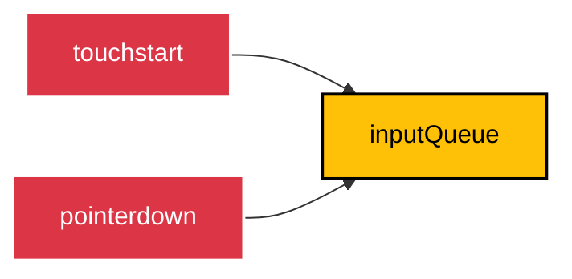
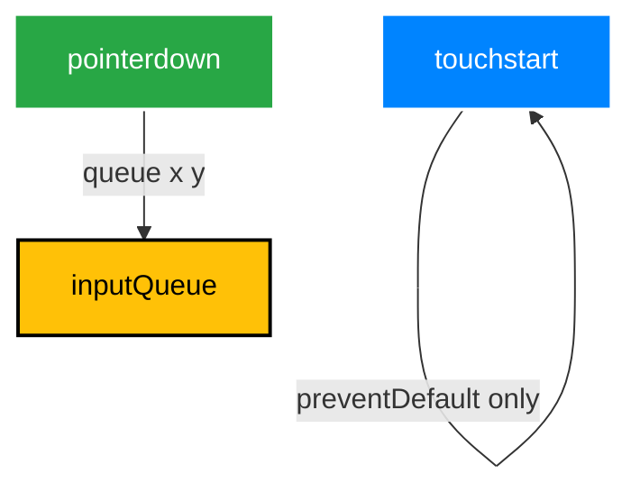
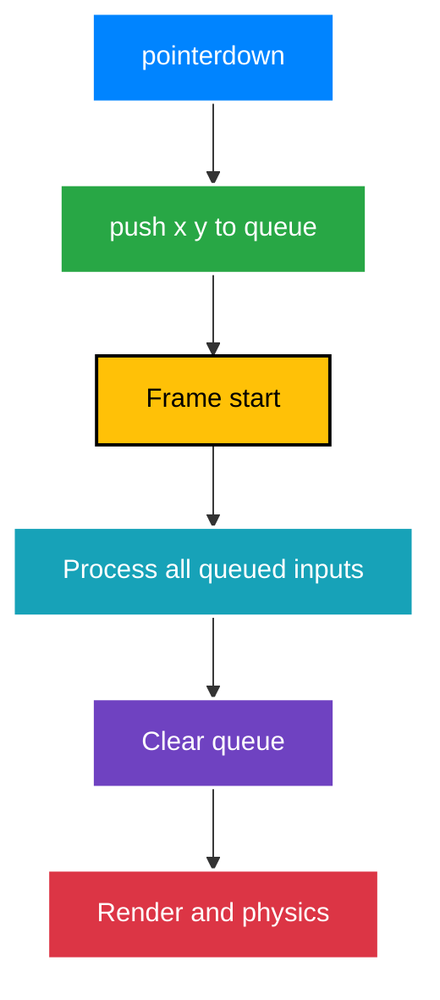

<div align="center">
  
  <h1>Slime Pop — Touch Tester</h1>
  <p><em>LIDAR / TUIO touch setup — responsive ball-throw input in the browser</em></p>
</div>

Touch tester / demo for **Hokuyo LIDAR** + **TUIO**: balls thrown at a projected screen become touch input. This doc is for getting **touch/LIDAR interaction responsive and reliable** so another dev or LLM can reproduce the setup and tradeoffs.

---

## Contents

- [System architecture](#system-architecture)
- [Why browser touch feels worse than native](#why-browser-touch-feels-worse-than-native-eg-ms-paint)
- [What we do: single event source + queue](#what-we-do-single-event-source--queue)
- [Event listener setup](#event-listener-setup-exact-choices)
- [What we explicitly avoid](#what-we-explicitly-avoid)
- [Touch-only fallback](#if-you-use-touch-events-instead-of-pointer-events)
- [Multi-touch](#multi-touch-multiple-balls-at-once)
- [Debugging](#debugging-lidar--tuio-in-the-browser)
- [Performance optimizations](#performance--latency-optimizations-for-lidar)
- [File layout](#file-layout)
- [For LLMs](#for-llms-continuing-this-project)

---

## System architecture

| Stage | What happens |
|-------|----------------|
| **LIDAR** | Detects impact position on the projected surface. |
| **TUIO** | Translates to touch/cursor protocol (e.g. over UDP). |
| **OS** | Delivers as Windows Touch (or equivalent). |
| **Browser** | Fires `pointerdown` / `pointermove` / `pointerup`. |
| **Game** | Pushes `(x, y)` into queue; processes queue at start of each frame. |

The browser does **not** see LIDAR. It sees normal pointer/touch events. TUIO turns each LIDAR “blob” or cursor into a pointer; **multiple balls = multiple pointers**.

---

## Why browser touch feels worse than native (e.g. MS Paint)

Typical causes when using TUIO/LIDAR in a browser:

| # | Problem | Effect |
|---|---------|--------|
| 1 | **Throttling** | Rate-limiting (e.g. “at most once per 16 ms”) drops rapid ball hits. |
| 2 | **Wrong event** | Using `click` instead of `pointerdown`/`touchstart` adds delay and can merge or drop inputs. |
| 3 | **Wrong touch list** | `e.touches` = all current touches; `e.changedTouches` = touches that *just* appeared. Using the wrong one doubles or drops inputs. |
| 4 | **Deduplication** | Time or position-based dedup can treat separate ball impacts as duplicates. |
| 5 | **Heavy work in listener** | Hit detection, DOM, or sound in the handler blocks the thread and delays/drops the next event. |
| 6 | **Missing `preventDefault()`** | Browser scroll/zoom runs and steals or delays touch. |
| 7 | **Double event source** | If both `touchstart` and `pointerdown` queue, you get two hits per ball. |



**Goal:** Minimal work in the listener, **one** canonical event source, no throttling/dedup, process all inputs at a **predictable time** (start of frame).

---

## What we do: single event source + queue

### 1. One event source: Pointer events (not touch for queueing)

We use **pointer events** as the only place we push into the input queue:

- **pointerdown** — one event per finger/cursor/ball; good for multi-touch and TUIO.
- **pointermove** — for “hold and drag” (e.g. auto fire, rocket aim).
- **pointerup** / **pointercancel** — release and cleanup.

We **do not** queue from `touchstart`. On many setups both `touchstart` and `pointerdown` (with `pointerType === 'touch'`) fire for the same touch; queueing in both would double-count.



| Listener | Role |
|----------|------|
| **touchstart** | `e.preventDefault()` only — stop scroll/zoom; **no queueing**. |
| **pointerdown** | Queue `(clientX, clientY)` for **all** pointer types (touch, pen, mouse). |

Result: **one queue entry per physical impact**, full multi-touch.

### 2. Queue: store only (x, y, timestamp)

In the listener we do the smallest possible work:

```javascript
function queueInput(x, y) {
    inputQueue.push({ x: x, y: y, t: performance.now() });
}

canvas.addEventListener('pointerdown', (e) => {
    e.preventDefault();
    queueInput(e.clientX, e.clientY);
}, { passive: false, capture: true });
```

No hit detection, no sound, no DOM — keeps the handler fast and avoids dropping the next event.

### 3. Process queue at the start of the game loop

Every frame, **before** any rendering or physics:



```javascript
function gameLoop(timestamp) {
    const queueLen = inputQueue.length;
    if (queueLen > 0) {
        for (let i = 0; i < queueLen; i++) {
            const input = inputQueue[i];
            processQueuedInput(input.x, input.y);
        }
        inputQueue.length = 0;
    }
    // ... then screen shake, clear canvas, update/draw, etc.
}
```

**Tradeoffs:**

| Pro | Con |
|-----|-----|
| Input never lost during a heavy frame. | Input delayed by up to one frame (~16 ms). |
| Hit detection in one place, in order. | For LIDAR ball throws this delay is acceptable. |

### 4. Defer heavy work inside `processQueuedInput`

When an input hits a target:

- **Synchronous:** game state (score, remove/split slimes, push explosions).
- **Deferred:** sound and DOM (so they don’t block the next input or frame):

```javascript
setTimeout(() => {
    if (soundManager) soundManager.playImpact(hitType);
    scoreDisplay.textContent = `slimes popped: ${score}`;
    // ...
}, 0);
```

So: **hit detection and game state are immediate**; **audio and score UI are deferred**. That keeps the critical path responsive for LIDAR.

---

## Event listener setup (exact choices)

These matter for TUIO/LIDAR:

| Choice | Where | Reason |
|--------|--------|--------|
| **`passive: false`** | pointerdown, touchstart, touchmove, touchend | Required to call `preventDefault()` and stop scroll/zoom. |
| **`capture: true`** | All of the above | Handle in capture phase so we see events first. |
| **touchstart** | Only `preventDefault()` | No queueing — avoids double input with pointerdown. |
| **touchmove / touchend** | `preventDefault()` | Stop browser from treating as scroll/gesture. |
| **contextmenu** | `preventDefault()` | Stop right-click menu from interfering. |
| **pointermove / pointerup / pointercancel** | `passive: true` OK | We only read position; no `preventDefault()` needed. |

**Canvas CSS:** `touch-action: none` — tells the browser we handle touch; reduces delay and accidental gestures.

---

## What we explicitly avoid

- **No throttling** — Every pointerdown is queued.
- **No position-based dedup** — Two balls close together = two inputs.
- **No time-based dedup** — Two quick taps = two inputs.
- **No `click` for primary input** — Too late; can merge with touch.
- **No hit detection in the listener** — Only push `{ x, y, t }`; hit detection in the loop.
- **No touch ID tracking** — We only care about “new down”; simpler and fewer bugs.

---

## If you use touch events instead of pointer events

If you must use **only** touch events:

1. Use **`changedTouches`**, not `touches`. For each `touchstart`, iterate `e.changedTouches` and queue one entry per touch.
2. Keep **one queue** and **process at start of frame**.
3. Keep the listener to **“push (clientX, clientY)” only**.
4. Use **touchstart** (not touchend) so you react as soon as the ball is detected.

---

## Multi-touch (multiple balls at once)

Because we queue from **pointerdown** (one event per pointer), multiple fingers or TUIO cursors naturally produce multiple queue entries per frame. The loop processes all of them; each can hit a different target.

For “hold and drag” we keep a map by **`pointerId`** and update position on **pointermove**, clear on **pointerup** / **pointercancel**, so each pointer is independent.

---

## Debugging LIDAR / TUIO in the browser

**Check that events arrive and aren’t doubled:**

```javascript
canvas.addEventListener('pointerdown', (e) => {
    console.log('pointerdown', e.pointerId, e.pointerType, e.clientX, e.clientY);
}, { passive: true, capture: true });
```

If you see two pointerdowns for one ball, only one of them should push to the queue (our setup: only pointerdown queues).

**Check for queue backlog:** Log `inputQueue.length` at the start of each frame (before processing). If it grows unbounded, you’re queuing faster than you process (e.g. game loop stopped or very slow).

---

## Performance / latency optimizations (for LIDAR)

1. **Input queue** — Store only `{ x, y, t }`; process at start of frame.
2. **Hit test without sqrt** — `dx*dx + dy*dy < radiusSq` instead of `Math.sqrt()`.
3. **Precompute hit radius squared** per slime in the constructor.
4. **Deferred sound** — `setTimeout(..., 0)` so it’s off the critical path.
5. **Deferred DOM** — Score/UI updates in the same `setTimeout` as sound.
6. **`performance.now()`** for timestamps (not `Date.now()`).
7. **`capture: true`** so our listeners run first.
8. **No touch ID set** — No per-touch bookkeeping; each event is “new impact.”

---

## File layout

```
.
├── index.html   # Canvas + UI
├── style.css    # Layout, canvas fullscreen, touch-action
├── game.js      # Input queue, listeners, game loop, hit detection
├── thumbs.png   # README header
└── README.md    # This file
```

Tunable game/config (spawn rate, sizes, physics) are at the top of `game.js` in `CONFIG` and related constants.

---

## For LLMs continuing this project

| Topic | Rule |
|-------|------|
| **Context** | Input is LIDAR → TUIO → browser pointer/touch. Responsiveness matters; avoid throttling, dedup, or heavy work in listeners. |
| **Queue** | One place pushes `(x, y)` on pointerdown; game loop processes the queue at the **very start** of each frame, then physics and draw. |
| **Touch vs pointer** | Queue only from pointerdown. Touch listeners are only for `preventDefault()`. |
| **Testing** | Use multiple rapid taps (or TUIO cursors); confirm each produces one hit and no dropped or doubled inputs. |
