<div align="center">
  
  <h1>Alien Invasion</h1>
  <p><em>The LiDAR boss fight from Galilean Mission</em></p>
</div>

Alien Invasion is the final battle of **Galilean Mission**, a 20-minute space mission at KidsSTOP, Science Centre Singapore (March to October 2026). Children crew a ship to Jupiter's moons, then defend it by throwing balls at a projection wall while a Hokuyo LiDAR sensor tracks where they land. The team reported 19,177 participants over the run.

This repository is the browser game that runs on that wall, plus a small Node.js server that lets show-control hardware start, pause, and end it. The rest of the exhibit (the story, the room, the media server and show control) is not in this repo.

Case study: [kentlimanza.co/work/galilean-mission](https://kentlimanza.co/work/galilean-mission)

## What's here

- A PixiJS game with a 2.5D projection: aliens walk from the back of the room toward the front line, and a thrown ball is a pointer event at the point where it hit.
- An input queue built so that hits aren't dropped on heavy frames.
- A state controller (start, pause, end) driven by keyboard or UDP, with Web Audio that pauses and resumes in step with the game clock.
- Windows kiosk scripts that launch the game unattended, including a startup click so the browser allows audio.

It also runs on a normal desktop: the game listens for pointer events, so a mouse or touchscreen works for testing without any LiDAR.

---

## 🚀 Quick Start

1. **Install Dependencies**:
   ```bash
   npm install
   ```

2. **Launch Game Server**:
   ```bash
   npm start
   # or run start_game.bat
   ```
   The game will be available at [http://localhost:3000](http://localhost:3000).

3. **Trigger Commands via UDP**:
   Send plain text strings to UDP port `41234`.
   ```bash
   ./send_udp_start.bat
   ```
   *Supported Commands:* `start`, `pause`, `end`, `9`.

---

## 🏗️ System Architecture

The project consists of a high-performance frontend engine and a Node.js utility server.

### 1. Data Flow (LIDAR to Browser)
| Component       | Responsibility                                               |
| --------------- | ------------------------------------------------------------ |
| **LIDAR**       | Detects physical impact on the screen.                       |
| **TUIO**        | Translates raw LIDAR data to cursor/touch protocols.         |
| **OS**          | Delivers events as Windows Touch / Pointer events.           |
| **Browser**     | Fires `pointerdown` events to the game canvas.               |
| **Game Engine** | Queues inputs and processes them at the start of each frame. |

### 2. Remote Control System (UDP & WS)
A control path allows external hardware or scripts to control the game state:
- **UDP Port 41234** listens for triggers (see commands below).
- **Server** broadcasts these commands to all connected browsers via **WebSockets**.
- **Game Engine** implements a **State Controller** that handles transitions, timeline jumps, and simulation pausing.

---

## 🎮 Controls & State Management

| Action               | Keyboard                 | UDP Command |
| :------------------- | :----------------------- | :---------- |
| **Start Game**       | `Space` (when IDLE)      | `start`     |
| **Pause / Resume**   | `Space` (during play)    | `pause`     |
| **End Game / Reset** | `9` (during play/paused) | `end`       |
| **Toggle Debug**     | `1`                      | —           |

### Game State Controller
- **Pause/Resume**: Freezes the simulation and the game clock. HTML Audio is synced precisely to pause and resume from the exact same timestamp.
- **Immediate End**: The `9` command fast-forwards the clock to the absolute end (93s), triggering alien explosions and immediately returning to the IDLE screen.
- **Audio Unlocking**: Implements a one-shot "user-gesture" unlock for HTML Audio on the first interaction, ensuring UDP-triggered music playback works reliably in commercial/kiosk browsers.
- **Kiosk Startup Fallback**: `start_game.bat` also schedules an automated center-screen click as a backup unlock gesture when no physical touch occurs during boot.

---

## 🎮 Key Systems

### LIDAR-Optimized Input Queue
To prevent "dropped hits" during heavy frames, the game uses a non-throttled input queue:
- **One Source**: Only `pointerdown` pushes to the queue. `touchstart` is used solely for `preventDefault()`.
- **Predictable Processing**: The queue is emptied and processed at the very beginning of the `gameLoop`, before physics and rendering.
- **Zero Work in Listener**: Hit detection and audio triggers are deferred to the loop or a `setTimeout(0)` to keep the main thread responsive.

### 2.5D Projection & Sprites
The game creates a 3D depth effect on a 2D canvas using:
- **Focal Length**: Controls perspective distortion.
- **Z-Mapping**: Entities move from `Z_START` (far) to `STOP_Z` (front line).
- **Z-Sorting**: `zIndex` is dynamically set to `-z` so closer objects always overlay distant ones.
- **Visual Fog**: A tinting system darkens objects as they recede into the distance.

### Audio Timeline & Ambiance
- **Dynamic Footsteps**: Volume scales based on the number of aliens currently on screen.
- **Spatial Grunts**: Alien sounds are panned based on their screen position.
- **Timeline Events**: Scripted voice-overs and music cues are triggered at specific seconds (defined in `config.js`).

---

## ⚙️ Configuration

The game is highly tunable via `src/config.js`. Key parameters include:

- **TIMELINE**: Total duration, spawn end times, and kill triggers.
- **WAVES**: Array defining start/end times and alien counts for each stage.
- **BOSS**: Health, scale, and movement behavior.
- **AUDIO**: Volume levels and chance-per-frame for random grunts.

---

## 📂 File Layout

```text
.
├── src/
│   ├── main.js             # Application entry point
│   ├── Game.js             # Core engine & state management
│   ├── config.js           # Centralized game balance & settings
│   ├── entities/           # Logic for Pirate, Spaceship, Explosions
│   └── managers/           # Asset loading and Sound management
├── assets/                 # WebP sequences, audio, and textures
├── server.js               # HTTP + WebSocket + UDP bridge server
├── index.html              # Canvas container & PixiJS loader
├── style.css               # Layout & touch-normalization
├── start_game.bat          # Utility to boot the server
├── SimulateStartupClick.ps1 # Startup fallback click for browser audio unlock
└── send_udp_start.bat      # Utility to test UDP triggers
```

> [!NOTE]
> The root `game.js` and `config.js` are legacy monolithic versions. Active development occurs within the `src/` directory using ES Modules.

---

## 🛠️ Performance Optimizations

1. **Hit Testing**: Uses squared distance comparisons to avoid expensive `Math.sqrt()` calls.
2. **Batch Loading**: Asset sequences are pre-loaded to prevent "pop-in" during gameplay.
3. **Layering**: Separate `PIXI.Container` layers for Shadows, Entities, and UI to minimize z-sort recalculations.
4. **Touch Action**: `touch-action: none` on the canvas to eliminate the browser's 300ms tap delay.

---

## Credits

- **Kesh** built the baseline gameplay, the Pixi.js migration, the waves and stages, and the early asset work.
- **Kent** ([@kent12t](https://github.com/kent12t)) wrote the multitouch input handling, the UDP-to-WebSocket control bridge, the game-state controller, the move to Web Audio, the kiosk startup scripts, and changes that came out of playtesting with children.
- Graphics, assets, and spatial design for the exhibit were by Clarita; the media server and show control were connected by an external team.
- `LidarCalibSoftware/` is a third-party LiDAR calibration and multitouch tool (Windows binaries) that turns sensor data into touch input. It is not my work and carries its own licences; see `LidarCalibSoftware/multitouch/doc/`.
